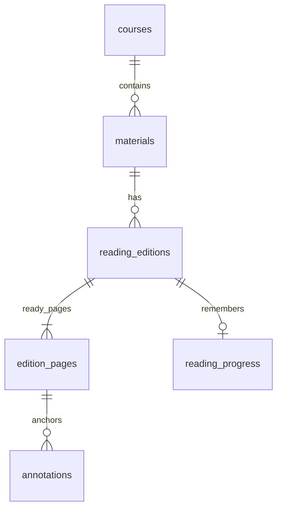

# PLW 课程课件阅读与标注专项

> 0.2.1 更新：已实现紧凑阅读布局、拖动阅读、键盘翻页、专注全屏及本地课件文字查找。最新验收见 [PROJECT_STATUS](PROJECT_STATUS.md)；下文保留原设计与后续目标。

日期：2026-10-11。状态：R1/R2 基础课件阅读、全部基础标记及备份接入已实现；连续滚动、缩略图、OCR、全文搜索和笔压等增强体验待后续优化。

## 1. 已确认的核心体验

> 当前实现、与规划的差异和实际验收以 [0.2 实现说明](IMPLEMENTATION_V02.md) 与 [项目状态](PROJECT_STATUS.md) 为准。下面保留原需求及设计目标；其中历史里程碑说明和未实现增强项不是本次交付能力声明。

用户需要按课程整理 PPT/PPTX 或 PDF 课件，像电子书一样方便查阅并随手标记。PDF 是独立入口，不要求安装或调用 PowerPoint。已确认先保证静态页面阅读，PPT 动画可用 PowerPoint 打开；书签、文字批注、重点/疑问、荧光笔、框选、手写都需要。分阶段交付是实现顺序，不是取消其中任一类。

主要流程：进入课程 → 按章节或顺序找课件 → 回到上次阅读位置 → 阅读、标记与写疑问 → 查看保存结果 → 下次继续阅读或集中复习标记。任务、AI、知识图谱不阻塞这一闭环。

| 区域 | 目标行为 |
| --- | --- |
| 首页 | 继续阅读、最近课程/课件、未解决疑问、快速添加；后续补今日任务 |
| 课程书架 | 课件封面缩略图、显示名、顺序、页数、上次位置、标记数；显示名/顺序不改变原文件 |
| 阅读器左栏 | 课程内课件与当前课件缩略图，可收起；章节分组可选 |
| 阅读器中间 | 连续滚动和单页切换、页码跳转、缩放/适合宽度、键盘翻页、专注模式；保留 16:9、4:3 或其他原比例 |
| 阅读器右栏 | 当前页批注、书签、重点/疑问；点击标记回到页内位置；可收起 |
| 复习入口 | 按课程/课件/类型筛选全部标记；疑问可手动设为已解决，保留原内容 |

R1 先提供显式上移/下移排序，拖放作为后续体验优化，不以动画或仿真翻书特效替代可读性。翻过的页面和阅读位置不代表知识掌握程度。

## 2. 当前事实与未验证项

- 项目已有 M2 课程、资料与完整备份服务，当前仍只允许合成数据。schema 为 1；001_core.sql 不得重写。
- 本机存在 `C:\Program Files\Microsoft Office\root\Office16\POWERPNT.EXE`，文件版本 `16.0.14334.20918`。R0 已实际通过 COM 只读打开合成 PPTX/PPT 并导出 PDF，包含隐藏页；未退出用户原有 PowerPoint。该结果只覆盖已测样本，不是任意课件的保真保证。
- PATH 未解析到 POWERPNT/soffice；已检查的常见 LibreOffice 安装位置未找到程序，不等于全盘证明没有安装。
- 项目 .venv 依赖未改变；样本生成复用 bundled runtime 的文档工具，PDF.js 5.6.205 复用其中已有资源并附许可证/哈希清单，没有安装依赖。
- Streamlit components/v2 已实际承载 PDF.js 页面与标记操作；重跑、失败重试、缩放/旋转、像素密度 2 和重启保存通过合成检查。长期绘画延迟、峰值内存与真实笔设备仍未实测。
- 官方接口核对已补上合成运行证据。当前没有正式课程书架、正式阅读版本数据库或阅读数据备份，不能把 R0 原型外推为 R1/R2 已完成。

## 3. 技术选择

建议：**PPT/PPTX 保留来源并转换为固定 PDF；原生 PDF 直接建立固定阅读版本；两者共用本地 PDF.js 与独立标记。** PDF 无需重复转换。原始文件继续遵守 M2 的复制/引用与删除规则。

PowerPoint 的 ExportAsFixedFormat 提供静态 PDF 输出，适合当前静态阅读要求；不把它等同于动画逐帧导出。候选自动转换优先评估本机已有 PowerPoint，同时保留用户手动导出 PDF 的入口。[Microsoft 导出接口](https://learn.microsoft.com/en-us/office/vba/api/powerpoint.presentation.exportasfixedformat)

PDF.js 分离解析、显示与阅读器层，可自建阅读界面。本项目拟打包固定版本及所需 worker、字符映射、字体等资源，运行时不用 CDN；是否漏资源须断网验证。使用本机 HTTP 服务，而不是直接依赖 file://。[PDF.js 官方说明](https://mozilla.github.io/pdf.js/getting_started/)

Streamlit 自定义组件可以向 Python 发送状态和事件，但发送会触发重跑。翻页动画、滚动、缩放和绘画过程先在前端完成；整笔/完整操作才提交，保持稳定组件 key，并验证重跑不重置画布。[组件注册与通信](https://docs.streamlit.io/develop/concepts/custom-components/components-v2/register)

| 方案 | 优点 | 边界与结论 |
| --- | --- | --- |
| PowerPoint → PDF | 使用现有桌面软件的导出能力 | 字体、公式、图表和隐藏页须实测；Office 未激活、占用或弹窗应报告并退出，不自动修环境 |
| 手动导出 PDF → PLW | 不依赖自动化插件，便于逐页核对 | 步骤更多，但作为稳定备用入口；必须记录人工配对的来源和页映射 |
| LibreOffice 本地转换 | 提供批量转换命令 | 额外软件和版式差异须评估；本轮不安装，不作为首个依赖 |
| 浏览器自带 PDF 查看器 | 接入成本低 | PLW 的标记事件、统一持久化和手写控制需专门接口，不能用简单嵌入冒充全部需求 |
| 本地 PDF.js + PLW 标记层 | 阅读与标记交互可控，可绑定课程及版本 | 需维护少量前端、离线资源、坐标变换与保存协议；作为 R0 首选 |
| 独立前端 + Python 服务 | 更容易控制复杂前端生命周期 | 若 Streamlit 组件门槛实测失败再采用，复用现有数据/备份服务；不预先重写全栈 |

LibreOffice 确有 convert-to/outdir 等转换参数，但这不证明本机的兼容性或效果。[官方命令说明](https://help.libreoffice.org/latest/en-US/text/shared/guide/start_parameters.html)

python-pptx 主要用于读取、创建和更新 PPTX 结构、提取文字等；这些能力不能作为版式渲染保真证据，因此不拿“提取文字后拼页面”替代课件显示。[官方功能范围](https://python-pptx.readthedocs.io/en/latest/)

## 4. 来源、阅读版和存储边界

1. managed_copy 保留托管 PPT 原件，在显式“准备阅读”后另生成 PDF；不覆盖原件。PDF 资料也可建立固定阅读版，避免绑定未来会改变的内容。
2. external_reference 默认只保存路径。另行点击“生成本地阅读副本”时明确说明会保存包含课件内容的 PDF、占用空间且纳入备份。拒绝时仍可用原软件打开，不暗中生成磁盘副本。
3. 外部 PDF 若仅直接打开，PLW 不承诺离开来源后重现页面；R1/R2 的稳定标注闭环以已明确保存的固定阅读版为前提。不要在界面混淆“引用原件”和“已经保存阅读副本”。
4. 阅读版按独立 UUID 保存；记录来源和 PDF 的 SHA-256。转换结果改变即建立新版本；旧版本及标记保持可读，不按同文件名/页号自动迁移。
5. PPT 一页对应一页 PDF 为默认导出规则。隐藏页默认包含并标示；显式保留 PDF 页号到原幻灯片序号的映射。人工配对无法核实映射时显示“未核实”，不伪造对应关系；讲义多页拼一页不作为自动配对默认格式。
6. PDF 阅读版是持久学习数据，即使尚未标注也不自动清理。缩略图是可再生成缓存，与权威页面文件区分。隐藏资料保留全部阅读版、进度和标记。
7. 转换仅处理用户选择的文件；来源只读，不执行宏或更新外部链接。关闭时只处理该操作打开的文档，不能退出或强杀用户已有的 PowerPoint 实例。独立工作进程、超时与失败现场处理在 R0 验证。
8. 原件已变化时提示“来源有更新”，仍可阅读旧版本；建立新版本是明确操作，旧标记不会自动带过去。

## 5. 最小数据模型（待迁移实现）

保留 materials 作为课程资料入口，不立即引入通用知识图谱或全局文件版本引擎。新增表的命名与约束在 R1 编写迁移前定稿：

| 表/变更 | 关键字段与关系 |
| --- | --- |
| reading_editions | id、material_id FK、source_sha256/size、pdf_relpath/size/sha256、converter/version/options、page_count、status、created_at；ready 后正文与几何元数据不可变 |
| edition_pages | edition_id + page_index 复合主键；0 基页号、CropBox、原始旋转、页尺寸、可空 source_slide_number、映射核实状态 |
| reading_progress | edition_id 主键、page_index、页内位置、显示模式、zoom、updated_at、revision；页面用组合 FK 校验 |
| annotations | id、edition_id + page_index 组合 FK、type/subtype、正文、geometry_json、geometry_schema、颜色/线宽、revision、created_at/updated_at/deleted_at、疑问解决状态 |
| reader_operations | 独立的转换/阅读提交操作日志，request_id 唯一、请求摘要、目标版本、阶段、结果与错误；按实际操作类型约束并限大小 |
| materials 排序扩展 | 课程内 sort_order；相同顺序以 id 稳定排序；章节分组优先复用 chapter_materials，不能创建跨课程章节归属 |

书签、批注和图形共用 annotations：type 可为 bookmark/comment/marker/highlight/rectangle/ink；重点/疑问使用 marker 的 subtype。前端展示的七类功能不要求七张表。读到哪里和课程知识点的掌握状态独立。

全部连接延续外键开启、短事务、写屏障和活动数据集检查。页号非负且必须存在，正文长度、坐标个数/数值/类型应有上限；拒绝 NaN、无穷值、越页锚点、未知几何格式。编辑携带 expected_revision，不能让第二个标签页覆盖较新批注。重复请求必须比较内容后复用结果，不能依赖会话内布尔值防重。

现有 file_operations.kind 的 CHECK 仅允许既有类型，不能直接塞入转换操作。采用独立 reader_operations，不修改 001_core.sql；通过新的迁移增加结构与幂等操作域。删除服务也须扩展影响统计：存在阅读版/标记时阻止原有简化永久删除流程，先给出完整受影响范围，不由 FK 级联删除正文。

## 6. 标注坐标与保存协议

- 标记锚定 edition_id、PDF 哈希与 page_index。规范坐标定义为未旋转 CropBox 内、左上原点、x/y 归一化到 0–1；保存几何格式版本。页面 PDF 坐标、旋转、缩放、设备像素比与 CSS 大小均通过明确的正/逆变换处理，不保存屏幕像素作为永久位置。
- 文本高亮保存每段四边形与辅助摘录，多行不得当一个大矩形覆盖；文字层不可用时允许区域荧光笔。摘录用于展示/核对，不替代版本锚点，不承诺文字识别。
- 矩形存页面内边界；手写存逐笔折线、页面相对线宽和颜色。鼠标/触控笔先支持基本 Pointer 输入；压感和防误触不作未经实机验证的承诺。
- pointermove 在前端绘制；pointerup 提交完整笔画。前端保持待确认队列，携带操作 UUID、版本与修订号；后端幂等提交后 ACK，收到 ACK 才显示“已保存”。离开当前页前处理待提交操作，失败保留当前会话队列并显示重试入口。
- 组件重跑、切页和服务重启不得使已提交笔画丢失。浏览器突然退出前尚未获得保存确认的内容不保证可恢复；不能把仅在浏览器内显示当作已经写盘。
- 撤销/重做以完整操作为单位，作为新的持久操作提交；删除用逻辑删除留痕。R2 首版承诺当前编辑会话的撤销/重做，跨重启保留编辑结果，不宣称已有完整跨会话撤销栈。
- 阅读位置低频、防抖保存，不把每一帧滚动发给 Python。切换数据集/恢复时旧组件消息必须拒绝，避免迟到的笔画写入另一个数据集。

## 7. 完整备份、恢复与旧版本兼容

**从 R1 开始接入，不推迟到 R2。** 当前 backups.py 只接受 database/config/managed/note_revision 清单类型，并精确核对文件树；新阅读 PDF 放入数据集会被现有代码拒绝。扩展必须与阅读存储同时完成。

备份同时包含：SQLite 的阅读版/页信息/全部保留标记/已保存位置，以及所有登记的 PDF 阅读版；隐藏资料、旧阅读版仍保留。缩略图可重建，须在格式规则中明确排除/重建策略，不能简单放宽“未知文件”校验。阅读数据也不应被藏在 notes 或伪装成原始 managed 正文来绕过白名单。

外部原件与阅读版分开报告：原 PPT `included=false`；用户明确生成的阅读 PDF `included=true`；标注与位置在数据库中。备份读取既有阅读版，不重新访问外部原件、不临时转换。恢复后即使 PowerPoint 不可用或外部原件缺失，仍能重现已保存的阅读版和标记。

转换使用暂存与持久操作日志，校验 PDF 可解析、页数/映射/大小/哈希后发布；失败保留现场，不能显示准备完成。转换与备份共用写入屏障；存在未解决阅读发布操作时拒绝完整备份并解释原因。只有操作核对通过后才继续，不能备份半成品或静默漏页。

schema/清单升级须先解决兼容性：

1. 保留 schema 1 和旧清单格式的只读验证规则，按原格式验证原备份，不使用“必须等于最新版本”的单一判断。
2. 恢复至独立新数据集，先核对迁移前表/文件，再在副本事务迁移；迁移后验证保留旧数据、初始化新结构、外键与内部文件一致性。
3. 保存当前数据完整回滚副本；新数据全部验证通过后才切换活动指针。未知/未来版本继续拒绝；不修改原备份数据库。
4. schema 1 老应用拒绝新库是预期行为；降级使用旧应用和匹配的迁移前数据副本，不能对新库删字段“回退”。schema 与清单格式独立标版本，双向兼容能力不能靠修改版本号伪装。

恢复验收必须实际打开恢复的阅读 PDF、叠加标记，并比较版本/页/坐标/正文/笔画；仅 integrity_check 通过不足以证明标记恢复正确。

## 8. 分阶段实现与验收

### R0：合成课件与阅读技术探针

- 目标：确定转换和阅读组件能承接核心需求，不迁移活动 M2 数据。
- 预计模块：独立 scripts/reader_probe、reader 前端探针、本地资源清单、tests/reader_probe；产物只在新的 .sandbox 阅读探针目录，不能绕过现有数据路径保护。
- 顺序：合成 PPTX/PDF → 转换前后来源哈希/mtime → 静态 PDF 保真 → PDF.js 本地资源 → Streamlit 前端生命周期 → 坐标往返与模拟笔画 → 记录性能和限制。先查明新增依赖/资源版本、来源与许可证，再按该独立任务的授权范围获取，不更改全局环境。
- 自动化：页数/映射、中文路径、来源不变、资源请求拦截；50%/100%/200% 缩放、窗口与侧栏变化、0/90/180/270 度显示旋转、设备像素比 1/2 的坐标往返；重复事件、重跑、迟到事件；超时/不可转换/损坏 PDF 不发布成功。
- 人工验收：中文中英混排、矩阵/积分/分式、表格、图片、流程图、16:9/4:3、隐藏页和动画覆盖页。逐页比较是否缺字、遮挡、裁切、关键公式或图线损坏；动画中间步骤不作为静态模式承诺。PPTX 为首要样本，旧 PPT 单列支持情况，不能由扩展名推断成功。
- 性能记录：建议 30/100/300 页合成样本，记录硬件、文件体积、首屏、翻页和连续绘画耗时/内存。候选门槛为就绪文件 100 页首屏不超过 3 秒、已渲染翻页不超过 200 毫秒、前端笔迹可见延迟不超过 50 毫秒；均是待校准目标，不是实测成绩，初次 PPT 转换单列时间。
- 完成标准：核心内容视觉正确、无必需外连、已绘制笔迹在重跑后保留、坐标目标误差不超过 1 CSS 像素（在指定探针尺寸下）；失败项明确决定修复/替代方案，不能把只画空白 canvas 当 PDF 标注验证。
- 风险与回滚：Office 授权/弹窗、字体替换、内存、组件重挂载；停止独立探针，保留现有 M2。只关闭属于探针的文档/进程，不强杀用户 Office；不迁移库、不处理真实文件。

### R1：课程书架、基础阅读与可恢复标记

- 目标：按课程组织课件并可续读，书签/批注/重点疑问可保存、回看和完整恢复。
- 预计模块：新迁移、editions、reader_operations、reading_progress、annotations、reader UI/frontend、materials 排序与删除影响、backups/workspace 兼容；对应迁移/服务/浏览器测试。
- 顺序：旧备份兼容与副本迁移 → 版本/页/操作结构 → 固定 PDF 发布及完整备份 → 书架顺序 → 阅读与位置 → 基础标记 → 标记列表/回跳 → 完整恢复。
- 自动化：组合外键、非法页号、发布/提交失败、请求去重、修订冲突、失活数据集拒写、源更新不改旧标记；schema 1 备份升级恢复与失败回滚、阅读版损坏/遗漏/未知文件拒绝、外部原件仍不被备份自动读取。
- 人工验收：两门合成课程，各至少三份课件，整理顺序、切换与续读、四类基础标记；关闭重启后检查位置；更新来源后旧标记不漂移；恢复到新数据集，原件不可用时仍能读已保存 PDF。
- 完成标准：上述闭环与新旧备份兼容通过；保存状态准确，全部阅读版及标记进入完整备份。R1 不宣称图形标记已完成。
- 风险与回滚：新 schema/清单不兼容、重复提交、转换文件残留；迁移前完整副本，副本失败不切换，保留旧应用配套旧数据；禁用新页面不能代替数据回滚。

### R2：荧光笔、框选、手写与阅读体验优化

- 目标：交付用户要求的全部标记类型，使阅读页成为主要学习入口。
- 预计模块：frontend 标记层/工具栏/输入、annotations 几何校验与操作队列、标记筛选、浏览器截图与恢复集成测试；必要时新增迁移，不能改已应用 R1 迁移。
- 顺序：区域和多行文本高亮 → 矩形框 → 手写整笔提交 → 颜色/线宽/编辑/删除 → 撤销重做 → 疑问回看 → 视口渲染和内存优化 → 恢复后视觉验收。
- 自动化：缩放/旋转/侧栏/设备像素比不漂移，页边界与混合尺寸；无文字层高亮降级，极端/非法坐标、笔画长度限制、快速连续多笔、同请求重发；断开连接、保存失败、重启、恢复切换时不误报保存或写错版本。
- 人工验收：在公式上圈选、表格内高亮、图示旁手写、添加文字疑问，翻页和缩放后检查遮盖/位置；鼠标必须通过，有触控笔时另记实机结果；重启及恢复后逐页回看，源文件哈希保持不变。
- 完成标准：书签、文字批注、重点、疑问、荧光笔、矩形框、手写全部可用；已提交结果恢复一致；候选性能门槛经 R0 实测确定并记录，核心阅读不依赖外部软件或 AI。
- 风险与回滚：高频事件导致重跑、几何错误、笔迹丢失；前端局部绘制、幂等 ACK、版本冲突、限制负载；回退界面保留几何数据和 PDF，不把不支持的标记静默删除。

## 9. 当前决定与后置项

目前无需再次确认标记范围。默认课程书架以阅读为主，先鼠标及基本触控笔、固定 PDF、PLW 内标记；不要求动画内嵌。手动导出 PDF 是转换备用方案。AI、OCR、全库全文搜索、原 PPT 批注回写、标准 PDF 批注互通、压感/防误触和跨设备同步后置；这些不影响既定七类标记的交付。

没有启用真实资料目录，也没有读取用户课件。读取真实资料、安装额外软件与修改环境不由本设计自动授权。R0 已有单独运行、仅允许合成文件的技术原型；实际测试与仍未验证项按 R0_READER_RESULTS.md 记录。

## 10. 下一轮最小开发任务提示词

> 开始 PLW 的 R1 最小数据闭环。先读取 R0_READER_RESULTS.md，保留原生 PDF、PPT/PPTX 双入口及现有阅读组件回归。优先实现原生 PDF 的不可变阅读版本、页信息与标记模型，同时实现 schema 1 旧备份的原格式验证、恢复至副本、迁移后核对及安全切换。只在独立合成数据集验收，不直接迁移活动 M2 库、不修改 001_core.sql、不导入真实课件、不改变系统或其他项目环境。新阅读 PDF 与已提交标记必须同批纳入完整备份；该闭环通过后再接课程书架。PPT 自动转换的异常处理及复杂保真补测按 R0 未完成清单补齐，在通过前保留手动导出 PDF 的路径。报告实际测试，不将 R0 原型当正式功能。
